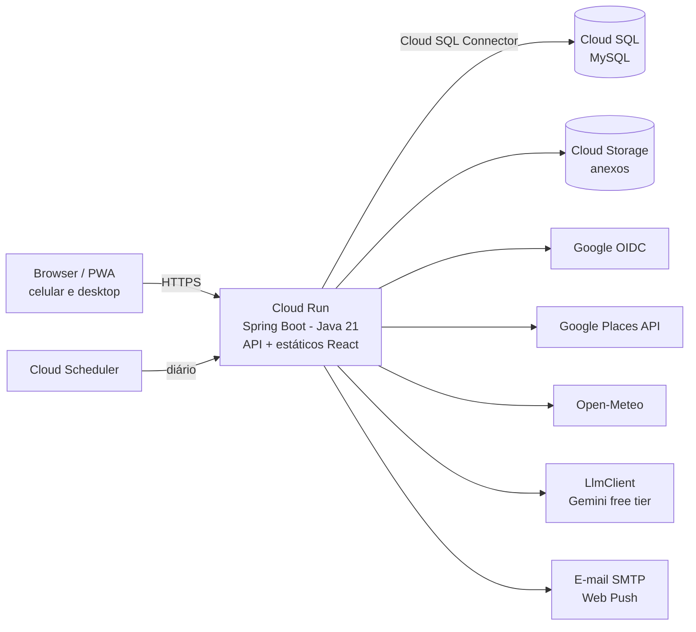
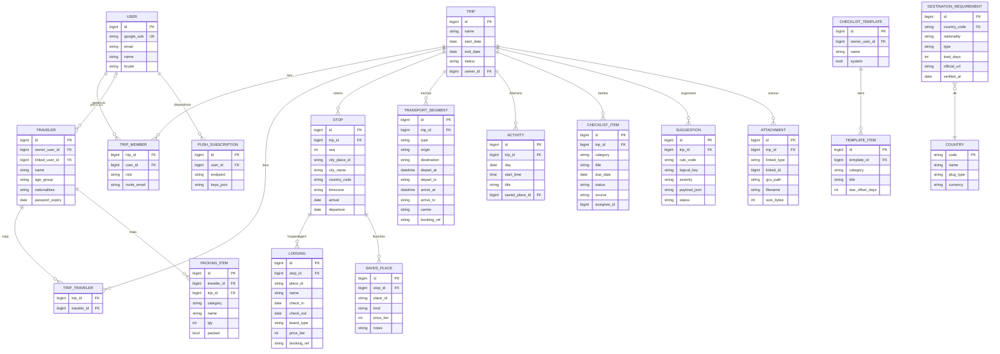

# Travel Planner — Especificação

> Documento derivado de [`ideias.md`](./ideias.md). Detalha a visão, a viabilidade, o escopo por fases, a arquitetura, o modelo de dados e os custos.

## 1. Visão

Um sistema web, pensado primeiro para o celular, para planejar viagens em família/grupo. O diferencial não é ser mais um app de reservas, e sim um **assistente que olha a viagem e aponta o que está faltando**: "você chega em Punta Cana às 14h e não tem transporte até o hotel", "faltam 3 dias e o e-Ticket ainda não foi preenchido", "vai fazer 30 °C, leve 5 bermudas".

### Princípios

1. **O planejamento é do usuário, o sistema só sugere.** Nada é reservado automaticamente; as sugestões trazem links (Booking, Uber, site oficial) para o usuário agir.
2. **As regras vêm antes da IA.** A detecção do que falta é feita por regras determinísticas, que são testáveis e confiáveis. A IA entra para enriquecer (textos, listas de mala, recomendações) e nunca como única fonte de informação crítica, como exigência de documentos. O sistema **funciona completo sem IA**.
3. **Custo zero sempre que possível.** O uso é pessoal ou de poucos usuários. Toda dependência paga deve caber no nível gratuito e ter **quotas configuradas** para nunca gerar cobrança inesperada (ver §8).

---

## 2. Análise de viabilidade

| Requisito | Viabilidade | Observação |
|---|---|---|
| Acesso via browser, responsivo | ✅ Alta | SPA responsiva + PWA (instalável e com checklist offline durante a viagem). |
| Login Google | ✅ Alta | Spring Security OAuth2 Client / OpenID Connect. Só os escopos `openid email profile`, sem verificação do Google. |
| CRUD de viagens (datas, cidades, períodos, transporte) | ✅ Alta | Núcleo do sistema, só depende de você. |
| Partilhar viagens | ✅ Alta | Convite por e-mail + papéis (dono/editor/leitor). |
| Dashboard | ✅ Alta | Próximas viagens, progresso dos checklists, alertas com prazo. |
| Lista de hotéis com categoria, avaliação e **faixa de preço** | ✅ Alta | Google Places API traz categoria, avaliação e `priceLevel`, que já é uma escala de `$` a `$$$$`. Como o preço é só indicativo, não é preciso API de reservas. Quando o `priceLevel` faltar, há fallback (ver §3.1). |
| Sugestões do que falta (transfer, transporte local, restaurantes, resort, pontos turísticos) | ✅ Alta (regras) / ✅ Média (conteúdo) | A detecção de lacunas é fácil com regras. O conteúdo (restaurantes, atrações) vem do Places API. "Opções do resort" não existe em API: só via IA ou cadastro manual. |
| Ajuda com as malas | ✅ Alta | Regra base (dias × pessoas × clima) + previsão do tempo (Open-Meteo) + ajuste opcional por IA. |
| Lembrete de documentos (ex.: e-Ticket República Dominicana) | ⚠️ Média | Não há API gratuita confiável. As pagas são IATA Timatic e Sherpa. Caminho viável: **tabela curada** de requisitos por país/nacionalidade, com link para a fonte oficial e data da última verificação. |
| GCP + MySQL existente + Java | ✅ Alta | **Cloud Run** (Java 21, Spring Boot) no mesmo projeto GCP + Cloud SQL MySQL existente via *Cloud SQL Java Connector*. Atenção ao *cold start* do Spring Boot (ver §7.4). |

**Conclusão:** o projeto é viável e pode rodar com custo adicional praticamente zero (o Cloud SQL você já paga). O único ponto com mais risco é **requisitos de documentos**, resolvido com a base curada, e ele não bloqueia o MVP.

---

## 3. Respostas às *open questions*

### 3.1 Hotéis
- **Fonte: Google Places API (New)**, com Text Search do tipo `"hotels in <cidade>"` / `includedType=lodging`. Traz nome, avaliação, nº de avaliações, `priceLevel`, fotos, site, localização e telefone.
- **Faixa de preço (`$` a `$$$$`):**

  | `priceLevel` do Places | Exibição | Significado |
  |---|---|---|
  | `PRICE_LEVEL_INEXPENSIVE` | `$` | Barato |
  | `PRICE_LEVEL_MODERATE` | `$$` | Moderado |
  | `PRICE_LEVEL_EXPENSIVE` | `$$$` | Caro |
  | `PRICE_LEVEL_VERY_EXPENSIVE` | `$$$$` | Muito caro |

  - O `priceLevel` é frequente em restaurantes, mas **costuma faltar em hotéis**. Fallback em cascata: (1) heurística pelo tipo do lugar (hostel/motel = `$`, pousada/B&B = `$$`, resort = `$$$`), marcada como "estimado"; (2) estimativa por IA, sob demanda; (3) ajuste manual pelo usuário, que fica salvo no favorito. O `priceRange` do Places foi descartado por ser raro em hospedagem e difícil de normalizar entre moedas.
  - Sempre exibir como indicativo, com um botão "ver preços" que abre o Booking/Google Hotels já com cidade e datas (link simples, sem integração).
- **Categorização:** "categoria" (hotel, resort, pousada, apartamento) vem do `primaryType` do Places. Filtros: avaliação mínima, faixa de preço, distância do centro/praia.
- **Termos de uso:** o Google **não permite guardar o conteúdo** do Places por tempo indefinido. É permitido guardar o `place_id`, então o sistema armazena o `place_id` + dados do usuário (favorito, notas, faixa de preço ajustada) e busca os detalhes sob demanda, com cache curto.

### 3.2 Restaurantes e locais turísticos
- **Google Places API**: `restaurant`, `tourist_attraction`, `museum`, `beach`, etc., por proximidade do hotel ou da cidade. A mesma escala `$`–`$$$$` vale para restaurantes.
- **Complemento gratuito opcional:** OpenStreetMap/Overpass (sem avaliações, mas sem custo nem quota de cobrança).
- **IA (opcional)** para curar: "dos 20 restaurantes retornados, quais 5 combinam com uma família com crianças?". A IA ordena e explica, mas os dados vêm do Places (assim evita-se inventar lugares).

### 3.3 IA sem custo

Não existe API da Anthropic (Claude) nem da OpenAI com nível gratuito. As opções sem fatura são:

| Opção | Custo | Prós | Contras |
|---|---|---|---|
| **Google Gemini API (AI Studio), nível gratuito** | Grátis, com limite de requisições por minuto/dia | Mesma conta Google, modelos bons (família Flash), suporta saída em JSON. Sobra muito para uso pessoal. | Os limites do nível gratuito mudam com frequência. Nele, o Google **pode usar os dados enviados para melhorar produtos**, então não enviar dados sensíveis (passaporte etc.). |
| **OpenRouter (modelos `:free`)** / **Groq** / **Cloudflare Workers AI** | Grátis com limites | API compatível com OpenAI, vários modelos abertos (Llama, Qwen, Gemma). | Disponibilidade e limites instáveis; bom como plano B. |
| **Modelo próprio no projeto** (ex.: Gemma/Llama via Ollama) | ❌ Não é grátis na prática | Dados não saem do projeto. | O container da aplicação não tem GPU nem memória para isso. Cloud Run com GPU é cobrado por hora; em CPU, só modelos minúsculos, lentos e de baixa qualidade. **Não recomendado.** |
| API paga (Claude Haiku, Gemini pago) | Centavos por mês no uso pessoal | Qualidade e estabilidade, sem uso dos dados para treino. | Exige cartão e fatura (pequena). |

**Recomendação:**
- Começar com o **nível gratuito do Gemini**.
- Isolar o provedor atrás de uma interface (`LlmClient`), com implementação por provedor escolhida por configuração. Trocar depois por OpenRouter ou um modelo pago é só configuração.
- **Guardar o resultado** de cada geração (ex.: lista de mala gerada) e só chamar a IA de novo quando a viagem mudar. Isso mantém o uso bem abaixo dos limites.
- Como o sistema funciona sem IA (princípio 2), estourar o limite só desativa os "extras" temporariamente.

Usos previstos:
- Ajustar a lista de mala a partir da regra base + clima + perfil dos viajantes.
- Ranquear e explicar sugestões de restaurantes/atrações a partir dos dados do Places.
- Gerar rascunhos de requisitos de entrada para a base curada, que você revisa antes de publicar.
- Usar **saídas estruturadas (JSON schema)** para que a resposta caia direto nas entidades.

### 3.4 Requisitos de documentos
- Tabela `destination_requirement` com país, nacionalidade (ou "todas"), tipo (visto, formulário eletrônico, vacina, seguro, passaporte com validade mínima), **antecedência** (ex.: e-Ticket até 72h antes), link oficial, data da última verificação.
- Na viagem, o sistema cruza destinos × nacionalidade dos viajantes e cria itens de checklist com **data limite** e lembrete.
- Aviso visível: "informação indicativa, confirme na fonte oficial".

**Nacionalidade coberta inicialmente: brasileira.** O modelo de dados continua aceitando outras (campo `nationality` na base e `nationalities` no viajante), mas o seed e a revisão cobrem só passaporte/RG brasileiro.

**Alimentação sob demanda** (a base cresce só com os destinos realmente usados):
1. **Seed inicial pequeno:** nacionalidade brasileira × destinos já visitados ou planejados. Candidatos, cada um a confirmar na fonte oficial antes de entrar na base:
   - República Dominicana: e-Ticket (formulário eletrônico de entrada e saída, com prazo antes do voo).
   - EUA: visto B1/B2.
   - Reino Unido: ETA (autorização eletrônica).
   - Espaço Schengen: isenção de visto até 90 dias; ETIAS quando entrar em vigor.
   - Canadá: eTA ou visto, conforme o histórico de vistos do viajante.
   - Países do Mercosul/associados: entrada com RG, com regras de validade/data de emissão do documento.
   - Países que exigem Certificado Internacional de Vacinação contra febre amarela para quem vem do Brasil.
2. **Destino sem dados:** ao criar uma viagem para um país sem registro, o sistema mostra o alerta **"sem informações de documentos para este destino"** (nunca um "não precisa de nada" silencioso) e oferece **"gerar rascunho com IA"**. O Gemini pesquisa e propõe os requisitos com os links das fontes; o usuário revisa e aprova antes de o registro valer.
3. **Revalidação:** registros com `verified_at` há mais de 6 meses, quando houver viagem para o país, geram a sugestão "revisar requisitos de <país>".

---

## 4. Sugestões aceitas

| # | Sugestão | Onde está detalhada |
|---|---|---|
| S1 | **Viajantes como entidade** (nome, faixa etária, nacionalidade, validade do passaporte) | §6.2, §9 |
| S2 | **Timeline / itinerário dia a dia** | §6.3 |
| S3 | **Motor de regras de lacunas** | §6.4 |
| S4 | **Templates de checklist** | §6.5 |
| S5 | **Lembretes por e-mail/push** | §6.8 |
| S6 | **PWA offline** | §6.9 |
| S7 | **Anexos** (PDFs de reservas, seguros, e-Ticket) | §6.10 |

---

## 5. Fora do escopo (por agora)

Orçamento, exportação para calendário (iCal), importação de reservas por e-mail/PDF, mapa interativo e preço real de hotel via afiliados.

---

## 6. Funcionalidades detalhadas

### 6.1 Autenticação e usuários
- Login exclusivo com Google (OIDC). Primeiro login cria o `user`.
- Sessão via cookie HTTP-only (Spring Session JDBC no MySQL, porque o Cloud Run pode ter várias instâncias e as instâncias são descartadas quando escalam a zero).
- Perfil: nome, foto, idioma, nacionalidade padrão.

### 6.2 Viagens e viajantes
- **Viagem:** nome, datas início/fim (derivadas dos trechos ou manuais), capa, status (`planejando`, `confirmada`, `em andamento`, `concluída`).
- **Viajantes (S1):** quem vai na viagem, com ou sem conta no sistema. Nome, faixa etária (bebê, criança, adolescente, adulto), nacionalidade(s), validade do passaporte. **Não guardar o número do passaporte.** Um viajante pode ser vinculado a um usuário e reaproveitado em outras viagens.
- **Destinos (paradas):** cidade (autocomplete do Places → `place_id`, país, lat/lng, fuso), data de chegada/saída. A ordem define o roteiro.
- **Transporte:** trechos com tipo (avião, carro, ônibus, trem, barco, transfer), origem, destino, data/hora de partida/chegada, companhia, nº do voo, código da reserva, anexo. Ida, volta e entre cidades.
- **Hospedagem:** por destino, hotel (`place_id` ou texto livre), check-in/check-out, reserva, regime (só quarto, café, all-inclusive), faixa de preço.
- **Partilhar:** convite por e-mail. Papéis: `OWNER`, `EDITOR`, `VIEWER`. O convidado entra com Google pelo mesmo e-mail. Link de leitura opcional (token revogável).

### 6.3 Timeline / itinerário (S2)
- Visão **dia a dia** da viagem, gerada a partir de transporte, hospedagem, check-ins/outs e itens com data. Cada dia mostra onde se dorme, deslocamentos (com horário local) e atividades planejadas.
- Dias com lacunas aparecem destacados ("sem hospedagem", "sem transporte entre cidades"), ligados às sugestões do motor (§6.4).
- O usuário pode adicionar atividades livres a um dia (ex.: "passeio de catamarã 9h") ou arrastar um lugar favorito para um dia.
- É a tela principal durante a viagem e precisa funcionar offline (§6.9).

### 6.4 Motor de lacunas e sugestões (S3)
Roda sempre que a viagem é alterada (e diariamente via cron, para regras de prazo). Cada regra é uma classe que implementa `GapRule` e gera **sugestões** com severidade, mensagem, ação sugerida e, quando aplicável, um item de checklist.

| Regra | Condição | Sugestão |
|---|---|---|
| `TRANSFER_CHEGADA` | Trecho de avião chega em cidade X e não existe transporte do aeroporto até a hospedagem | "Como você vai do aeroporto até o hotel?" → links Uber/transfer Booking |
| `TRANSFER_SAIDA` | Idem para a ida ao aeroporto | — |
| `NOITE_SEM_HOSPEDAGEM` | Existe noite entre início e fim sem hospedagem cobrindo | "Noite de 12/03 em Lisboa sem hospedagem" → lista de hotéis |
| `DESTINO_SEM_TRANSPORTE` | Duas paradas consecutivas sem trecho entre elas | "Como vai de Lisboa ao Porto?" |
| `TRANSPORTE_LOCAL` | Estadia ≥ N dias sem aluguel de carro nem nota de transporte local | Sugerir aluguel, transporte público, apps |
| `DOCUMENTO_DESTINO` | Requisito na base para país × nacionalidade de algum viajante | Item de checklist com data limite |
| `DESTINO_SEM_REQUISITOS` | País da viagem sem nenhum registro na base para a nacionalidade dos viajantes | "Sem informações de documentos para este destino" → gerar rascunho com IA |
| `REQUISITO_DESATUALIZADO` | Registro do país verificado há mais de 6 meses | "Revisar requisitos de <país>" |
| `PASSAPORTE_VALIDADE` | Passaporte de algum viajante expira < 6 meses após a volta | Alerta crítico |
| `CHECKIN_ONLINE` | Voo em < 48h | "Fazer check-in online" |
| `SEGURO_VIAGEM` | Viagem internacional sem item de seguro | Sugerir (obrigatório em Schengen) |
| `RESTAURANTES` / `ATRACOES` | Destino sem nenhum favorito | Sugestões do Places |
| `RESORT_OPCOES` | Hospedagem all-inclusive/resort | "Ver restaurantes à la carte/reservas do resort" |

- Sugestões podem ser **aceitas** (viram item/entidade), **adiadas** ou **dispensadas** (não reaparecem).
- Cada regra com testes unitários próprios. Novas regras entram sem mexer nas existentes.

### 6.5 Checklists e templates (S4)
- Itens com categoria (documentos, reservas, mala, casa, saúde, financeiro), responsável, data limite, status, origem (`MANUAL`, `REGRA`, `IA`, `TEMPLATE`).
- **Templates** do sistema: praia, neve, cidade, internacional, com bebê, com pet, "antes de sair de casa" (desligar gás, regar plantas, avisar banco, ativar roaming/eSIM).
- **Templates do usuário:** "salvar o checklist desta viagem como template". Ao criar uma viagem, o usuário escolhe um ou mais templates para aplicar.
- Itens de template podem ter data relativa (ex.: "7 dias antes da partida"), convertida em data limite ao aplicar.

### 6.6 Malas
- Entrada: viajantes (faixa etária), nº de dias, destinos, clima (Open-Meteo: previsão até ~16 dias antes, média histórica antes disso), tipo de viagem (praia, cidade, neve, negócios), lavanderia disponível.
- Regra base, ex.: roupa íntima = dias + 1, camisetas = min(dias, 7) se houver lavanderia, etc.
- IA (opcional) ajusta e acrescenta (protetor solar, adaptador de tomada do país, roupa de frio para o avião).
- Lista por viajante, marcável, e reaproveitável como template (§6.5).

### 6.7 Dashboard
- Próximas viagens com contagem regressiva e % de progresso.
- **Alertas com prazo** (o mais importante no topo): documentos, check-in, passaporte.
- Sugestões pendentes por viagem.
- Viagens passadas (histórico).

### 6.8 Lembretes (S5)
- **E-mail** (gratuito via SMTP do Gmail com senha de app, ~500 envios/dia, ou Brevo no nível gratuito) e **Web Push** do PWA (gratuito, protocolo padrão com chaves VAPID, sem serviço pago).
- Job diário (Cloud Scheduler chamando um endpoint protegido do Cloud Run, autenticado por OIDC da conta de serviço) verifica itens com data limite e regras de prazo e dispara: "e-Ticket vence em 3 dias", "check-in do voo abre hoje", "viagem em 7 dias: 4 itens pendentes".
- Preferências por usuário: canais ativos, antecedência, resumo diário ou alertas individuais.
- Evitar duplicidade: tabela `notification_log` registra o que já foi enviado.

### 6.9 PWA e modo offline (S6)
- Instalável na tela inicial do celular (manifest + service worker com Workbox).
- **Offline:** itinerário, checklists, malas, dados das reservas e anexos marcados como "disponível offline" ficam guardados no dispositivo (IndexedDB + cache do service worker).
- Marcar itens offline gera uma fila de alterações que sincroniza ao voltar a conexão. Conflito: vence a última alteração por item (suficiente para uso familiar).
- Busca de hotéis/restaurantes exige conexão.

### 6.10 Anexos (S7)
- Upload de PDFs/imagens (reservas, seguro, e-Ticket, vouchers), ligados à viagem e opcionalmente a um trecho, hospedagem ou item de checklist.
- Limite por arquivo (ex.: 10 MB) e tipos permitidos (PDF, JPG, PNG).
- Armazenamento no Cloud Storage dentro do nível gratuito (ver §8). Download passando pelo backend (mesma origem), só para membros da viagem. Isso permite o cache offline pelo service worker e dispensa a permissão de assinatura de URLs.

---

## 7. Arquitetura

### 7.1 Visão geral



### 7.2 Stack

| Camada | Escolha | Alternativa |
|---|---|---|
| Backend | Java 21, Spring Boot (última estável, 4.x), Spring Web, Spring Security (OAuth2 Client), Spring Data JPA, Flyway | Quarkus (cold start menor) |
| Banco | MySQL existente (schema próprio `travel_planner`) | — |
| Hospedagem | **Cloud Run**, um único container com a API e os estáticos do React. ✅ Decidido (§12) | — |
| Build / deploy | `Dockerfile` multi-stage (build do React → build Maven → JRE), construído no GitHub Actions e enviado ao Artifact Registry (com política de limpeza); deploy com Workload Identity Federation, sem chaves. Começar com JVM normal; imagem nativa GraalVM só se o cold start incomodar | — |
| Frontend | React + TypeScript + Vite, Tailwind, PWA (Workbox). O build do Vite é copiado para `static/` do Spring Boot e servido pelo mesmo container. ✅ Decidido (§12) | — |
| IA | Interface `LlmClient` + Gemini API (nível gratuito) | OpenRouter `:free`, ou API paga |
| Dados de lugares | Google Places API (New) | OSM/Overpass |
| Clima | Open-Meteo | — |
| E-mail / push | SMTP Gmail ou Brevo / Web Push (VAPID) | — |
| Anexos | Cloud Storage (bucket em região com nível gratuito) | — |
| Agendamento | Cloud Scheduler (até 3 jobs grátis) | — |

### 7.3 Organização do backend (módulos por domínio)

```
com.travelplanner
 ├─ auth          (OIDC, usuário, sessão)
 ├─ trip          (viagem, viajantes, paradas, transporte, hospedagem, membros)
 ├─ itinerary     (timeline dia a dia)
 ├─ checklist     (itens, templates)
 ├─ suggestion    (motor de regras, cada regra = uma classe que implementa GapRule)
 ├─ packing       (malas)
 ├─ places        (cliente Places + cache)
 ├─ requirements  (base de documentos por país)
 ├─ ai            (LlmClient, implementações por provedor, prompts, schemas)
 ├─ attachment    (upload/download, Cloud Storage)
 ├─ notification  (e-mail, web push, cron, log de envios)
 └─ shared        (erros, auditoria, utilidades)
```

### 7.4 Pontos de atenção no GCP
- **Cold start:** com escala a zero, a primeira requisição após um período parado sobe uma instância nova (Spring Boot na JVM: alguns segundos). Mitigações em ordem de custo: (1) *startup CPU boost* e *lazy initialization*; (2) **imagem nativa GraalVM** (o Spring Boot suporta; início em < 1 s, build mais lento); (3) `min-instances: 1`, que **sai do nível gratuito** e só deve ser usado se as anteriores não bastarem. Medir no protótipo.
- **Configuração inicial sugerida:** 1 vCPU, 512 MB–1 GB, `max-instances` baixo (ex.: 2) para limitar custo, cobrança por requisição (CPU só durante as requisições).
- **Região:** a mesma do Cloud SQL, para menor latência.
- **Conexão Cloud SQL:** usar `com.google.cloud.sql:mysql-socket-factory-connector-j-8` e um pool pequeno (HikariCP, 3–5 conexões), porque o MySQL é compartilhado com outros projetos.
- **Segredos:** chaves (Places, Gemini, OAuth, VAPID, SMTP) no **Secret Manager**, nunca no `app.yaml`.

---

## 8. Custos e níveis gratuitos

> Valores conferidos até a data deste documento. Os níveis gratuitos mudam, então confirme nas páginas de preço antes de ativar e **configure alertas de orçamento** no console (Billing → Budgets) com valor baixo (ex.: US$ 1).

| Serviço | É grátis? | Nível gratuito / condições | Como garantir custo zero |
|---|---|---|---|
| **Google Places API (New)** | ⚠️ Grátis até um limite mensal; exige conta de faturamento com cartão | Desde mar/2025, cada SKU tem uma cota mensal gratuita própria. Aproximadamente: **Essentials 10 mil**, **Pro 5 mil**, **Enterprise 1 mil** chamadas/mês. Campos como `rating` e `priceLevel` caem no SKU Enterprise de Place Details/Text Search, o que limita a ~1 mil buscas "completas"/mês. | Usar *field masks* (pedir só os campos usados); cache curto; guardar `place_id`; **definir quota diária máxima por API** no console (ex.: 30/dia por SKU Enterprise), o que faz a API recusar chamadas em vez de cobrar. Para uso pessoal, sobra bastante. |
| **Open-Meteo** | ✅ Grátis para **uso não comercial** | Sem chave de API. Limites: ~10 mil chamadas/dia, 5 mil/hora, 600/minuto. | Cache da previsão por cidade/dia. Uso comercial (vender o sistema) exige plano pago. |
| **Cloud Storage** | ✅ Grátis dentro do *Always Free* | **5 GB/mês** de armazenamento Standard, **só nas regiões `us-east1`, `us-west1` e `us-central1`**; 5 mil operações classe A e 50 mil classe B/mês; 100 GB/mês de saída (exceto China e Austrália). | Bucket numa dessas regiões, mesmo que o resto esteja em outra (a latência extra não importa para anexos). Limite de tamanho por arquivo. 5 GB são milhares de PDFs. |
| **Gemini API** | ✅ Nível gratuito | Limites por minuto e por dia que variam por modelo. Os dados podem ser usados pelo Google no nível gratuito. | Cache dos resultados; não enviar dados sensíveis; o sistema funciona sem IA. |
| **Cloud Run** | ✅ Nível gratuito mensal | Aproximadamente 2 milhões de requisições, 180 mil vCPU-segundos e 360 mil GiB-segundos por mês, por conta de faturamento. | Escala a zero, cobrança por requisição, `max-instances` baixo, sem `min-instances`. |
| **Artifact Registry** | ⚠️ 0,5 GB grátis | Imagens do Spring Boot têm ~200–300 MB. | Política de limpeza mantendo só as 1–2 imagens mais recentes. |
| **GitHub Actions** | ✅ Grátis para repositórios públicos; cota mensal gratuita para privados | Build da imagem e testes rodam no GitHub, sem uso de Cloud Build. | Builds de imagem nativa são mais longos; acompanhar o uso. |
| **Cloud Scheduler** | ✅ 3 jobs grátis por conta de faturamento | — | Um único job diário para os lembretes. |
| **Secret Manager** | ✅ Até 6 versões ativas e 10 mil acessos/mês | — | Ler os segredos uma vez na inicialização. |
| **E-mail / Web Push** | ✅ Grátis | Gmail SMTP ~500/dia; Brevo ~300/dia; Web Push sem custo. | — |
| **Cloud SQL (MySQL)** | 💲 Já pago por você | — | Usar um schema próprio na instância existente, sem custo adicional. |

---

## 9. Modelo de dados (inicial)



Observações:
- `price_tier` = 1 a 4 (`$` a `$$$$`), vindo do Places ou ajustado pelo usuário.
- Datas/horas de transporte guardadas com **fuso de cada ponta** (voos cruzam fusos).
- `SUGGESTION (trip_id, rule_code, logical_key)` é único, para que a regra não duplique sugestões a cada execução.
- `TRAVELER` pertence a um usuário e é reaproveitado entre viagens (a família não é recadastrada toda vez).

---

## 10. Roadmap por fases

### Fase 0: Fundação (1–2 semanas)
- Repositório, CI (GitHub Actions → deploy no Cloud Run), Flyway, Secret Manager, alertas de orçamento.
- Medir o cold start do Spring Boot na JVM e decidir se vale a imagem nativa.
- Login Google, layout responsivo, PWA básico (instalável).

### Fase 1: MVP "planejar e não esquecer"
- CRUD de viagem, viajantes, paradas, transporte, hospedagem.
- Timeline dia a dia.
- Partilhar com papéis.
- Checklists manuais + templates do sistema e do usuário.
- Motor de lacunas com as regras de transfer, noite sem hospedagem, destino sem transporte, check-in online e validade do passaporte.
- Dashboard com alertas.

### Fase 2: Descoberta e lembretes
- Integração Google Places: hotéis, restaurantes e atrações com faixa `$`–`$$$$`, filtros, favoritos.
- Base de requisitos de documentos (seed manual).
- Lembretes por e-mail e Web Push.
- Anexos.

### Fase 3: Inteligência e offline
- Malas (regra + clima + IA opcional).
- Ranking/explicação de sugestões por IA.
- Rascunho de requisitos de documentos por IA (com revisão humana).
- Modo offline completo com sincronização.

---

## 11. Requisitos não funcionais
- **Mobile-first:** tudo utilizável com uma mão, em telas de 360 px.
- **Segurança:** autorização por viagem em toda rota (`TripMember`), CSRF, cabeçalhos de segurança, anexos só via backend com checagem de acesso, sem número de passaporte.
- **Privacidade:** dados pessoais mínimos; nada sensível enviado à IA do nível gratuito; exclusão de conta apaga as viagens das quais o usuário é dono.
- **Custo:** alertas de orçamento + quotas diárias nas APIs pagas por uso (§8).
- **Observabilidade:** Cloud Logging + Error Reporting.
- **Testes:** cada regra do motor de lacunas com testes unitários; testes de integração com Testcontainers (MySQL).
- **i18n:** começar em pt-BR, estrutura pronta para en/es.

---

## 12. Decisões

### Tomadas
| Data | Decisão | Motivo |
|---|---|---|
| 2026-10-30 | **Frontend em React** (TypeScript + Vite), com o backend Java expondo uma API REST | O PWA offline (S6) e o itinerário interativo (S2) são centrais; com Thymeleaf o offline ficaria muito limitado. Aceita-se o custo de manter duas stacks. |
| 2026-10-30 | **Hospedagem no Cloud Run** (em vez do App Engine Standard), com o Cloud SQL existente (no mesmo projeto GCP ou num projeto próprio do app, acessando o banco de outro projeto) | O Spring Boot não cabe bem na instância gratuita do App Engine (F1, ~384 MB) e a cota gratuita lá é compartilhada com outros apps. O Cloud Run escala a zero dentro do nível gratuito, aceita 512 MB–1 GB e permite imagem nativa para resolver o cold start. |
| 2026-10-30 | **IA inicial: Gemini API no nível gratuito** (AI Studio, modelo da família Flash), atrás da interface `LlmClient` | Custo zero e qualidade suficiente para os usos previstos. Nenhum dado sensível é enviado (só destino, datas, clima e faixa etária). Trocar para Vertex AI ou Claude é só configuração, caso os limites ou a privacidade passem a pesar. |
| 2026-10-30 | **Base de requisitos de documentos: nacionalidade brasileira, alimentada sob demanda** (seed pequeno + rascunho por IA com revisão humana + revalidação a cada 6 meses) | Os viajantes são brasileiros. Cobrir o mundo todo seria inviável de manter; sob demanda, a base cresce só com os destinos usados e o sistema avisa quando não tem dados, em vez de omitir. |
| 2026-10-30 | **Identidade visual "Oceano"**: azul-petróleo como primária, coral como destaque, neutros frios (ver §13) | Tem cara de viagem, não colide com as cores de estado (vermelho/âmbar/azul/verde das sugestões) e a primária passa no contraste AA com texto branco. |

### Em aberto
Nenhuma no momento.

---

## 13. Identidade visual

Base: **shadcn/ui + Tailwind v4**. As cores são variáveis CSS no padrão do shadcn (`--primary`, `--card`, etc.) e tokens próprios para destaque e estados. Atenção: no shadcn, `--accent` é o fundo sutil de *hover*, não a cor de destaque; o coral fica em `--highlight`.

### 13.1 Estilo
- Limpo, em cards, mobile-first: fundo claro, cards brancos com cantos arredondados, bastante espaço em branco, sombras leves.
- Navegação inferior no celular e lateral no desktop; formulários em *bottom sheet*; botão flutuante "+" para a ação principal da tela.
- Alvos de toque com no mínimo **44 px**; margem lateral de **16 px**; espaçamento entre cards de **12 px**.
- Animações de 150–200 ms, respeitando `prefers-reduced-motion`.

### 13.2 Cores — tema claro

| Token | Valor | Uso |
|---|---|---|
| `--background` | `#F8FAFC` | Fundo da página |
| `--foreground` | `#0F172A` | Texto principal |
| `--card` / `--popover` | `#FFFFFF` | Cards, menus |
| `--card-foreground` | `#0F172A` | Texto em cards |
| `--muted` / `--secondary` | `#F1F5F9` | Fundos secundários, botões secundários |
| `--muted-foreground` | `#64748B` | Texto secundário (4,8:1 sobre branco) |
| `--border` / `--input` | `#E2E8F0` | Bordas, campos |
| `--primary` / `--ring` | `#0E7C86` | Botões, links, foco (4,9:1 com branco) |
| `--primary-foreground` | `#FFFFFF` | Texto sobre a primária |
| `--accent` | `#E6F4F5` | Hover/seleção sutil (padrão shadcn) |
| `--accent-foreground` | `#0B5F67` | Texto sobre `--accent` |
| `--highlight` | `#FF7A59` | Destaque: contagem regressiva, badges, ilustrações. **Nunca com texto branco** (2,6:1) |
| `--highlight-foreground` | `#1F2937` | Texto sobre o coral |
| `--highlight-soft` / texto | `#FFE8E1` / `#B23A1E` | Badge suave de destaque |
| `--destructive` | `#DC2626` | Crítico, vencido, excluir (4,8:1 com branco) |
| `--warning` / `--warning-soft` | `#B45309` / `#FEF3C7` | Atenção, prazo próximo, lacunas na timeline |
| `--info` / `--info-soft` | `#2563EB` / `#DBEAFE` | Sugestões informativas |
| `--success` / `--success-soft` | `#15803D` / `#DCFCE7` | Concluído, progresso completo |

### 13.3 Cores — tema escuro

| Token | Valor |
|---|---|
| `--background` | `#0F172A` |
| `--foreground` | `#F1F5F9` |
| `--card` / `--popover` | `#1E293B` |
| `--muted` / `--secondary` | `#1E293B` |
| `--muted-foreground` | `#94A3B8` |
| `--border` / `--input` | `#334155` |
| `--primary` / `--ring` | `#2DB3BD` |
| `--primary-foreground` | `#042F33` |
| `--accent` / `--accent-foreground` | `#12343A` / `#A5E3E8` |
| `--highlight` / `--highlight-foreground` | `#FF8A6B` / `#1F2937` |
| `--destructive` | `#F87171` |
| `--warning` / `--warning-soft` | `#FBBF24` / `#422006` |
| `--info` / `--info-soft` | `#60A5FA` / `#172554` |
| `--success` / `--success-soft` | `#4ADE80` / `#052E16` |

O modo escuro segue o sistema (`prefers-color-scheme`), com opção manual no perfil (claro / escuro / sistema).

### 13.4 Severidades e estados

| Situação | Visual |
|---|---|
| Sugestão CRITICAL / item vencido | Borda esquerda e ícone em `--destructive` |
| Sugestão WARNING / prazo em ≤ 7 dias | `--warning` sobre `--warning-soft` |
| Sugestão INFO | `--info` sobre `--info-soft` |
| Item concluído | Check em `--success`, texto riscado em `--muted-foreground` |
| Noite sem hospedagem (timeline) | Fundo `--warning-soft` com borda tracejada `--warning` |

### 13.5 Tipografia
- **Inter** (variável) para texto e números (`font-variant-numeric: tabular-nums` em datas, horários e quantidades).
- **Plus Jakarta Sans** (variável) para títulos.
- Ambas **auto-hospedadas** via `@fontsource-variable/*` (funcionam offline no PWA e dispensam liberar domínios de fontes na CSP).
- Escala: corpo **16 px** (evita o zoom automático do iOS em campos), secundário 14 px, títulos 20 / 24 / 28 px.

### 13.6 Forma e elevação
- `--radius: 0.875rem` (14 px) em cards e sheets; botões e campos com `calc(var(--radius) - 4px)`.
- Cards com `shadow-sm`; sheets, diálogos e botão flutuante com `shadow-lg`.

### 13.7 Padrões específicos
- **Faixa de preço:** sempre 4 cifrões, com os ativos em `--foreground` e os restantes em `--border` (ex.: **$$**$$). Faixa estimada: contorno pontilhado e tooltip "estimado".
- **Cards de viagem:** faixa colorida no topo com a cor da viagem e contagem regressiva em `--highlight`. Cores de viagem (decorativas): `#0E7C86`, `#E8613F`, `#1D6FB8`, `#7C5CC4`, `#3F8F5A`, `#C2477A`.
- **Timeline:** linha vertical à esquerda, com um ícone por tipo de evento em círculo `--accent`.
- **Ícones:** `lucide-react`, traço 1,75. Transporte: `Plane`, `TrainFront`, `Bus`, `Car`, `Ship`, `CarTaxiFront`. Países com bandeira em emoji.
- **Itens gerados por IA:** ícone `Sparkles` em `--highlight`.
